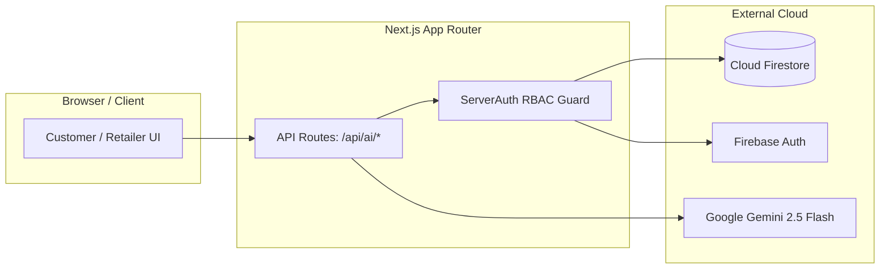

# Spatial Furniture AI

> An intelligent, full-stack spatial furniture planning and recommendation platform combining **Next.js (Turbopack)**, **Google Gemini 2.5 Flash Multimodal AI**, and **Firebase Cloud Services**.

[](https://nextjs.org/)
[](https://www.typescriptlang.org/)
[](https://tailwindcss.com/)
[](https://firebase.google.com/)
[](https://ai.google.dev/)
[](file:///docs/DEMO_AND_INTERVIEW_GUIDE.md)

---

## 1. Project Overview & Problem Statement

### The Problem
Selecting furniture online is plagued by spatial mismatch, style clashes, and high return rates. Customers struggle to visualize whether a piece of furniture will fit their room dimensions, match existing wall colors, harmonize with natural lighting, or block foot traffic paths.

### Our Solution
**Spatial Furniture AI** solves this by providing:
1. **Multimodal Room Analysis**: Upload a room photo and specific furniture dimensions to receive a comprehensive 6-dimension spatial evaluation from Google Gemini 2.5 Flash.
2. **Interactive Furniture Customizer**: Customize dimensions, materials, colors, and finishes in real-time.
3. **AI Style Recommendations**: Discover complementary catalog furniture tailored to the uploaded room's lighting, scale, and color harmony.
4. **Multi-Tenant Retailer & Admin Portals**: Allow retailers to manage their unique inventory with strict tenant isolation and enable admins to monitor platform integration health.

---

## 2. Features Actually Implemented

### 🛋️ Customer Experience
- **Public Product Discovery**: Search furniture by name, brand, material, or style; filter by category, price range, and stock availability.
- **Indian Rupee (INR `₹`) Formatting**: Accurate currency representation using the Indian numbering system.
- **Interactive Customizer**: Configure furniture dimensions (width, height, depth in cm), colors, materials, and finishes.
- **Spatial Room Analysis**: Upload room photos (JPEG, PNG, WebP up to 4.5MB) and receive structured Gemini 2.5 Flash architectural insights.
- **Room Analysis Dashboard**: Visual score gauges (0–100%) for Lighting, Color Harmony, Scale, and Safety Considerations.
- **AI Recommendation Engine**: Cross-catalog product suggestions with explainable "Why this fits your room" rationales.

### 🔐 Authentication & Security
- **Role-Based Access Control (RBAC)**: Distinct permissions for Visitors, Customers, Retailers, and Administrators.
- **Advanced User Registration**: Professional full name Unicode validation and live 4-tier password strength meter (Weak/Fair/Good/Strong).
- **Serverless Token Verification**: Validates Firebase ID tokens cryptographically via Google Identity Toolkit in serverless API routes without heavy SDK dependencies.
- **Hardened Database Rules**: Firestore security rules enforcing multi-tenant retailer ownership and blocking role escalation.
- **HTTP Security Headers**: `X-Frame-Options: DENY`, `X-Content-Type-Options: nosniff`, and strict referrer policies.

### 🏢 Retailer & Admin Operations
- **Retailer Inventory Management**: Complete CRUD operations for products with dimensions, stock tracking, and public image URLs.
- **Strict Tenant Isolation**: Retailers can only view, modify, and delete their own items; product ownership transfers are blocked at the rule level.
- **Admin Health Monitor**: Real-time operational diagnostics for the Gemini AI API integration.

---

## 3. Technology Stack

| Layer | Technologies |
| :--- | :--- |
| **Frontend Framework** | [Next.js](https://nextjs.org/) (App Router, Turbopack, React 19) |
| **Language & Styling** | [TypeScript](https://www.typescriptlang.org/), [Tailwind CSS](https://tailwindcss.com/) v4 |
| **Cloud Services & DB** | [Firebase Authentication](https://firebase.google.com/products/auth), [Cloud Firestore](https://firebase.google.com/products/firestore) |
| **Artificial Intelligence** | [Google Gemini 2.5 Flash](https://ai.google.dev/) via `@google/genai` SDK |
| **Testing & Quality** | [Vitest](https://vitest.dev/), [React Testing Library](https://testing-library.com/), [ESLint](https://eslint.org/) |

---

## 4. Architecture

Detailed technical architecture, sequence diagrams, and security boundaries are documented in [`docs/ARCHITECTURE.md`](docs/ARCHITECTURE.md).



---

## 5. Prerequisites & Local Setup

### Prerequisites
- **Node.js**: `v20.x` or `v24.x`
- **npm**: `v10.x` or later
- **Google Gemini API Key**: Free tier from [Google AI Studio](https://aistudio.google.com/)
- **Firebase Project**: Web App configuration from [Firebase Console](https://console.firebase.google.com/)

### Installation Steps

1. **Clone the repository**:
   ```bash
   git clone https://github.com/yashrajpatil12005-lab/spatial-furniture-ai.git
   cd spatial-furniture-ai
   ```

2. **Install dependencies**:
   ```bash
   npm install --legacy-peer-deps
   ```

3. **Configure Environment Variables**:
   Copy the example environment template:
   ```bash
   cp .env.example .env.local
   ```
   Open `.env.local` and add your Firebase credentials and Gemini API Key:
   ```env
   # Server-Side Only (Must NOT have NEXT_PUBLIC_ prefix)
   GEMINI_API_KEY=your_gemini_api_key

   # Firebase Client Credentials
   NEXT_PUBLIC_FIREBASE_API_KEY=your_firebase_api_key
   NEXT_PUBLIC_FIREBASE_AUTH_DOMAIN=your_project.firebaseapp.com
   NEXT_PUBLIC_FIREBASE_PROJECT_ID=your_project_id
   NEXT_PUBLIC_FIREBASE_STORAGE_BUCKET=your_project.appspot.com
   NEXT_PUBLIC_FIREBASE_MESSAGING_SENDER_ID=your_sender_id
   NEXT_PUBLIC_FIREBASE_APP_ID=your_app_id
   NEXT_PUBLIC_FIREBASE_MEASUREMENT_ID=your_measurement_id
   ```

4. **Run Development Server**:
   ```bash
   npm run dev
   ```
   Visit [http://localhost:3000](http://localhost:3000) in your browser.

---

## 6. Verification & Quality Commands

```bash
# Run ESLint validation
npm run lint

# Run TypeScript compilation check
npx tsc --noEmit

# Run automated test suite (70 tests across 7 suites)
npm run test

# Run tests with V8 code coverage report
npm run test:coverage

# Build optimized production bundle
npm run build
```

---

## 7. Project Documentation Index

- 📘 [**Architecture & System Design**](docs/ARCHITECTURE.md): Deep-dive on data pipelines, RBAC, Gemini prompt engineering, and security rules.
- 👥 [**Team Contribution Guide**](docs/TEAM_CONTRIBUTIONS.md): Four-teammate responsibility matrix for academic defense and presentations.
- 🎙️ [**Demo & Interview Guide**](docs/DEMO_AND_INTERVIEW_GUIDE.md): 10-minute repeatable demonstration script and answers to technical interview questions.

---

## 8. Honest Limitations & Roadmap

1. **AI Image Synthesis (Coming Soon)**:
   - Photorealistic furniture inpainting is transparently labeled **Coming Soon** in the UI.
   - Spatial evaluation, lighting harmony, and layout compatibility via Gemini 2.5 Flash are fully operational with zero experimental API billing.
2. **Live Firestore Security Rules Deployment**:
   - The security rules in `firestore.rules` are tested locally with unit tests, but require manual deployment to live Firebase (`firebase deploy --only firestore:rules`).
3. **Edge Rate Limiting**:
   - IP rate limiting at the network edge is planned for future enterprise hardening.

---

## 9. License

This project is licensed under the MIT License — see the [LICENSE](LICENSE) file for details.
