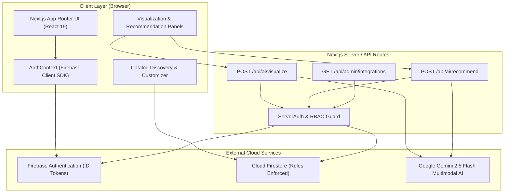
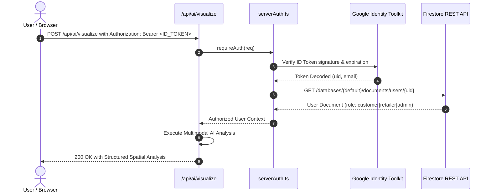
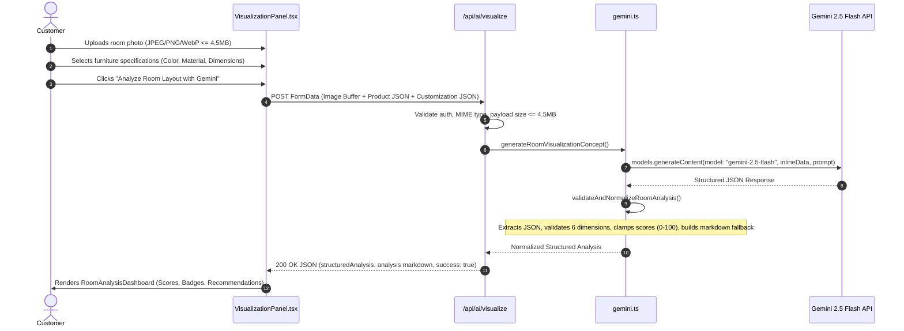

# Spatial Furniture AI — Architecture & Technical Design

This document details the software architecture, data pipelines, security boundaries, and AI integrations powering **Spatial Furniture AI**.

---

## 1. System Architecture Overview

Spatial Furniture AI is designed as a modern, decoupled full-stack application built with the Next.js App Router (Turbopack), Google Gemini 2.5 Flash, and Firebase Cloud Services.



---

## 2. Component & Directory Architecture

```text
spatial-furniture-ai/
├── firestore.rules               # Multi-tenant security rules with ownership immutability
├── next.config.ts                # HTTP security response headers & Next.js config
├── vitest.config.mts             # Vitest runner config (jsdom, path aliases)
├── vitest.setup.ts               # Testing Library Jest DOM extensions
├── .env.example                  # Documented environment variables template
├── docs/                         # Architecture, Contribution & Demo documentation
│   ├── ARCHITECTURE.md
│   ├── TEAM_CONTRIBUTIONS.md
│   └── DEMO_AND_INTERVIEW_GUIDE.md
└── src/
    ├── app/                      # Next.js App Router (Pages & API endpoints)
    │   ├── layout.tsx            # Global root layout with AuthProvider & Navbar
    │   ├── page.tsx              # Landing page (hero, value prop, how it works)
    │   ├── login/                # Customer/Retailer/Admin sign-in with code parsing
    │   ├── register/             # Account creation with live password strength meter
    │   ├── customer/             # Customer portal, catalog browsing, room visualizer
    │   ├── retailer/             # Retailer management portal (CRUD inventory)
    │   ├── admin/                # Admin platform integration health monitor
    │   └── api/                  # Server-side API endpoints
    │       ├── ai/visualize/     # Multimodal room layout & compatibility analysis
    │       ├── ai/recommend/     # AI style-match furniture recommendations
    │       └── admin/            # Platform health diagnostics
    ├── components/               # Modular presentation & container components
    │   ├── ai/                   # RoomAnalysisDashboard, VisualizationPanel, RecPanel
    │   ├── layout/               # Role-aware Navbar, Footer
    │   ├── products/             # ProductForm, CustomerProductDiscovery, Customizer
    │   └── ui/                   # Reusable UI badges, buttons, cards
    ├── lib/                      # Core business logic, services & utilities
    │   ├── ai/                   # Gemini client, room analysis parser, recommendation engine
    │   ├── firebase/             # Client SDK config, auth helpers, serverAuth guards
    │   ├── products/             # Product Firestore CRUD & initial catalog seeding
    │   └── utils/                # Currency formatting (INR), Unicode name & password validation
    └── __tests__/                # Vitest automated test suites (70 tests)
```

---

## 3. Authentication & Role-Based Access Control (RBAC)

Spatial Furniture AI enforces a 3-tier Role-Based Access Control model:

| Role | Access Permissions | Navigation Target | Verification Method |
| :--- | :--- | :--- | :--- |
| **Visitor** | Public landing page, product catalog browsing, product details | `/` | Anonymous |
| **Customer** | Visitor features + Authenticated room analysis, AI recommendations | `/customer` | Firebase ID Token + `role: "customer"` |
| **Retailer** | Product creation, editing, deleting own catalog, inventory management | `/retailer` | Firebase ID Token + `role: "retailer"` |
| **Admin** | Integration health monitoring, cross-catalog visibility, platform status | `/admin` | Firebase ID Token + `role: "admin"` |

### Server-Side Token & Role Verification Flow



### Serverless Security Guard Highlights:
- **No Heavy Admin SDK**: Uses lightweight Google Identity Toolkit and Firestore REST APIs in serverless routes, reducing cold starts while verifying cryptographic validity.
- **Header Hardening**: `X-Frame-Options: DENY`, `X-Content-Type-Options: nosniff`, `Referrer-Policy: strict-origin-when-cross-origin`.
- **Secret Protection**: `GEMINI_API_KEY` is strictly server-side (no `NEXT_PUBLIC_` prefix).

---

## 4. Multi-Tenant Firestore Security Architecture

Database access rules in `firestore.rules` isolate tenant data at the storage layer:

1. **User Identity Collection (`users/{userId}`)**:
   - Any authenticated user can read public user records (needed for retailer profile attribution).
   - Only the owning user can write their document upon registration.
   - **Role escalation protection**: New users can only assign themselves `customer` or `retailer`; assigning `admin` is rejected.
2. **Product Catalog Collection (`products/{productId}`)**:
   - `read`: Globally public (`allow read: if true;`) allowing prospective customers to browse without authentication.
   - `create`: Restricted to authenticated users with `role == 'retailer'` and `request.resource.data.retailerId == request.auth.uid`.
   - `update`: Enforces that only the retailer who created the product can update it AND `request.resource.data.retailerId == resource.data.retailerId` (prevents cross-tenant ownership transfer).
   - `delete`: Enforces `resource.data.retailerId == request.auth.uid`.

---

## 5. Gemini 2.5 Flash Multimodal Room Analysis Pipeline

The spatial analysis engine evaluates photographs of physical rooms against specific furniture items using Google's `gemini-2.5-flash` model.



### The 6 Evaluation Dimensions
Every room analysis produces structured scores (0-100) and actionable insights across:
1. **Room Type & Spatial Scale**: Ceiling height, room category, open floor square footage.
2. **Lighting & Natural Ambiance**: Window placement, daylight temperature, shadow casting.
3. **Color Harmony & Palette Fit**: Dominant wall/floor hues and complementary contrast with furniture.
4. **Furniture Compatibility & Scale**: Clearance paths, walking corridors, proportion match.
5. **Placement & Spatial Coordinates**: Recommended orientation, wall alignment, proximity to doors.
6. **Practical & Safety Considerations**: Electrical outlet access, heavy traffic flow, maintenance tips.

---

## 6. AI Recommendation Engine Architecture

When a room analysis is completed, [`src/lib/ai/recommendations.ts`](file:///c:/Users/Yashraj%20Patil/OneDrive/Documents/FIELD%20PROJECT/spatial-furniture-ai/src/lib/ai/recommendations.ts) evaluates available catalog items against the room analysis:

1. **Candidate Pool Filtering**: Excludes the currently selected product; selects items within matching or complementary categories.
2. **AI Ranking & Synthesis**: Gemini 2.5 Flash evaluates candidate items against room observations, producing a `compatibilityScore` (0-100), `matchReason` (e.g., "The oak frame matches your warm daylight and natural floor tone"), and a `suggestedZone` (e.g., "Adjacent to reading nook").
3. **Deterministic Fallback**: If the Gemini API is unavailable or quota-limited, a local rule-based heuristic scores products by category affinity and style keywords, ensuring zero broken UI states for the user.
